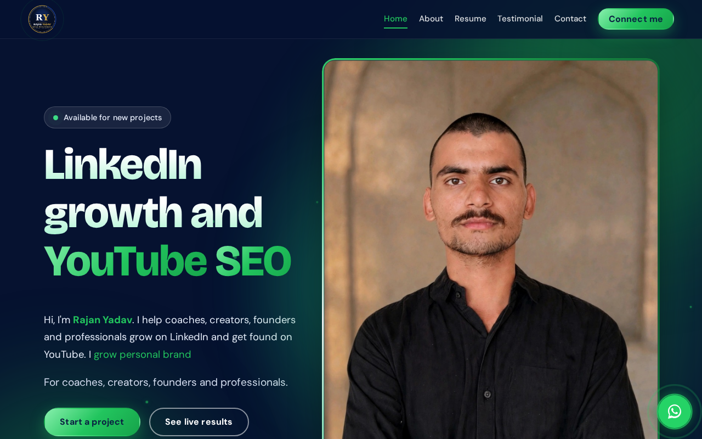
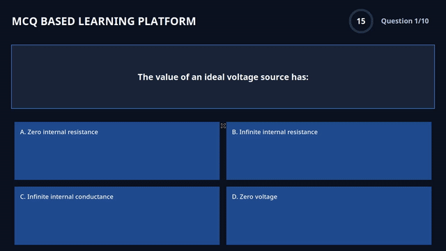
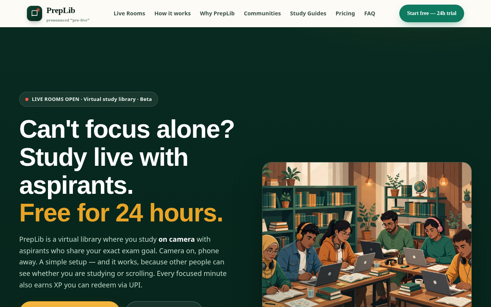
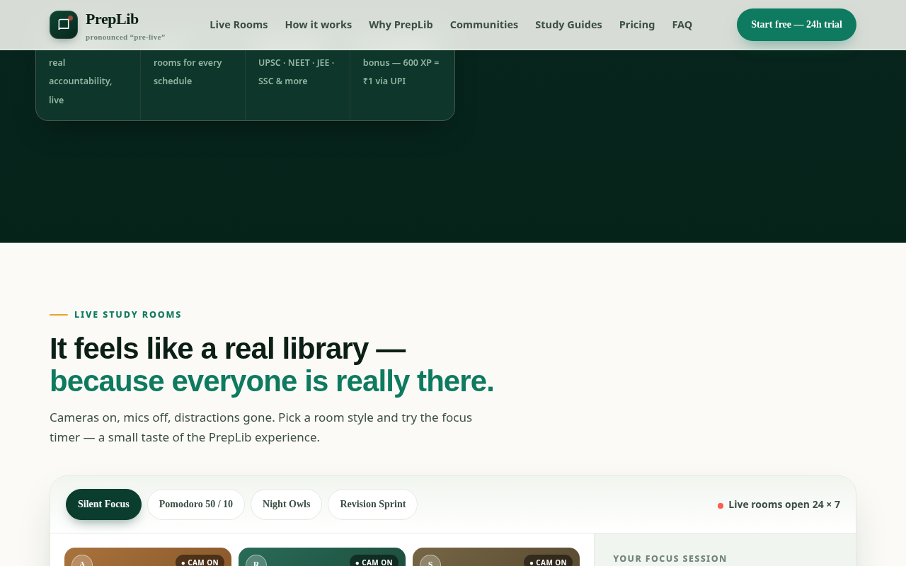
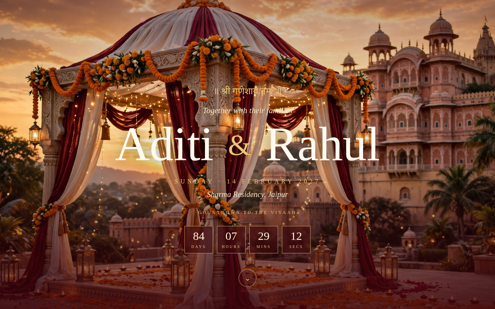
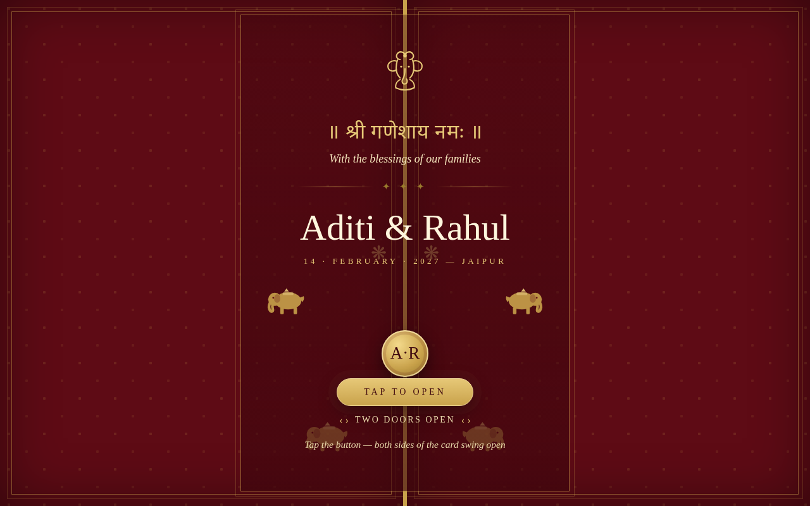

# Hi there, I'm Rajan Yadav 👋

## 👨‍💻 About Me

- 🎓 B.Tech Electronics & Communication student (2024–2027)

- 📜 Diploma in Computer Science & Engineering (2021–2024)

- 🚀 Social Media Manager, helping founders & professionals grow on LinkedIn with content that builds trust and gets them found

- 🎬 YouTube SEO: titles, descriptions, tags, thumbnails & growth packs

- 📝 Built a Substack newsletter from 0 → ~100 subscribers

- 📍 Based in Bhavnagar, Gujarat, India

- 🌱 Always learning, always building

## 🛠️ Tech Stack

**Frontend**

**Backend**

**Database**

**IoT & Hardware**

**Tools & DevOps**

**AI & Design Tools**

**Social Media & Growth**

## 📊 GitHub Stats

  
  

  

## 📈 Client results

- **Amarendra Nath Sasmal**, Time Reset Mentor · 1,432 profile views · 1,029 post impressions · 77 search appearances · 3,058 followers
- **Alexx Roy**, Freedom Lifestyle · 533 profile views · 821 post impressions · 30 search appearances · 2,740 followers

## 🚀 Featured Projects

| Project | Description | Tech Stack |
|---|---|---|
| [rajan-portfolio](https://rajan-portfolio-lemon.vercel.app) | My portfolio website: admin dashboard, contact form & analytics | Node.js, Express, PostgreSQL |
| [animated-portfolio](https://github.com/Rajanyadav2509/animated-portfolio) | Animated portfolio website: video-exact dark design, all pages animated & responsive | HTML, CSS, JavaScript |
| [ai-assistant-app](https://github.com/Rajanyadav2509/ai-assistant-app) | Riya AI assistant app: chat, exam prep & Dost mode with voice and PDF notes | JavaScript, Groq, OpenAI, Gemini |
| [mcq-learning-system-raspberry-pi](https://github.com/Rajanyadav2509/mcq-learning-system-raspberry-pi) | Hardware MCQ Learning System on Raspberry Pi: Flask admin panel + Tkinter touch quiz, Design Engineering 2B | Python, Flask, Tkinter, SQLite, Raspberry Pi, IoT |
| [preplib-landing](https://muse.ai/s/preplib-landing-preview-exp6xbxk6xspubu/8z9NgEVyx79QUGJuPOXUbRoBbcy3oOsJBP7nlpoSDAo) | PrepLib landing page: virtual study library — live camera-on study rooms, XP rewards, exam communities | HTML, CSS, JavaScript |
| [wedding-invitation-website](https://muse.ai/s/wedding-invitation-website-nxa6zlxdxmyxnxg5/RyG_WSaj8v4XDa21SQGDo6gCDMXB-ZrOA4HQ5I9Fn68) | Digital wedding invitation: maroon-and-gold patrika scroll, tap-to-open gate, live countdown, gallery | HTML, CSS, JavaScript |

## Website Previews

[Live demo — MCQ admin panel](https://mcq-learning-system-raspberry-pi.onrender.com/)

[Watch the quiz video](https://raw.githubusercontent.com/Rajanyadav2509/mcq-learning-system-raspberry-pi/main/videos/quiz-demo.mp4)

## 🗓️ My Content System

| Day | Focus |
|---|---|
| Monday | Educational post |
| Wednesday | Carousel |
| Friday | Personal story |
| Sunday | Opinion / insight |

System: **POSITION → PILLARS → FORMATS → ENGAGEMENT → REVIEW**

## 🎯 Current Focus

- 🔭 LinkedIn growth systems for founders & professionals
- 🎬 YouTube SEO growth packs
- 📝 Content systems that turn attention into trust
- 💻 Portfolio & web projects with Node.js

## 🔗 Let's Connect

✨ Open to LinkedIn Growth & Social Media Management opportunities ✨

